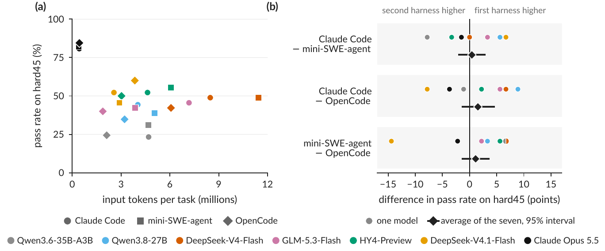
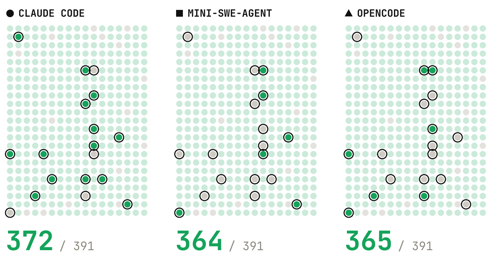
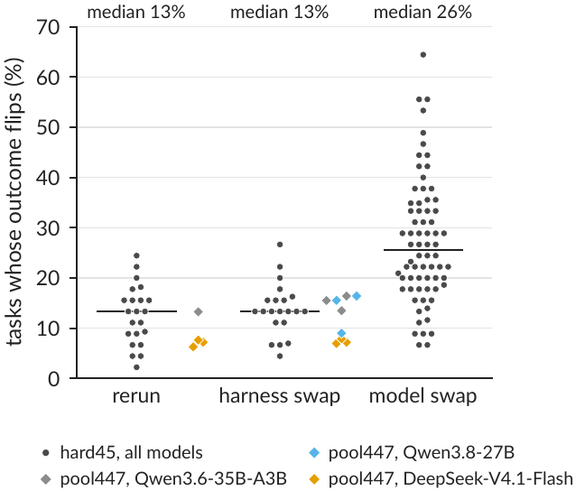

# What Does a Harness Buy? Tokens, Mostly.

Code and data for the paper "What Does a Harness Buy? Tokens, Mostly." by Yangze Liu and Zhongyi Han (Shandong University). Paper: [arXiv:2610.04433](https://arxiv.org/abs/2610.04433) (v2, November 2026).

<p align="center">
  
</p>

**Same model, three harnesses (Claude Code, mini-SWE-agent, OpenCode).** Across seven models no harness leads consistently, and swapping the harness changes about as many task outcomes as running the same harness again. Left: each colour is one model and each shape one harness, so the horizontal spread within a colour is the difference in input tokens between harnesses and the vertical spread the difference in pass rate. Right: the difference in pass rate between two harnesses on the 45 hardest tasks, one point per model. Single models fall on both sides of zero, and the average over the seven covers it.

<p align="center">
  
  &nbsp;
  
</p>

Left: Claude Opus 5.5 on 391 tasks, task by task. The three harnesses end the same way on 373 of them, and of the 19 to 27 tasks each harness fails, 15 are the same tasks. Right: the share of tasks whose outcome changes between two runs. On the hard tasks a rerun and a harness swap both change 13% at the median, and a model swap changes 26%.

Press: [VentureBeat](https://venturebeat.com/orchestration/a-coding-agents-harness-can-triple-its-cost-without-making-it-more-accurate-study-finds) (Oct 23, 2026), [The Decoder](https://the-decoder.com/fancy-harnesses-make-coding-agents-more-expensive-but-not-better-study-finds/) (Oct 24, 2026). Both report the first version of the paper.

## Summary

A coding agent is a language model inside a harness: the system prompt, the tools, and the context management that let a chat model work in a repository. Most of the engineering on these agents goes into the harness, and vendors and leaderboards credit it with score gains. The paper asks whether swapping the harness changes the pass rate more than running the same harness again. It runs seven models through three production harnesses on SWE-bench Verified and on two benchmarks of other kinds, and reruns every model with nothing changed, so that a difference between two harnesses can be read next to the difference between two runs of one harness.

No harness leads consistently across models. On the 45 hardest tasks (hard45), each of the three harnesses has the highest pass rate on some model, and averaged over the seven models no pair of harnesses differs. On the remaining 447 tasks (pool447), where the tasks suffice for a bound, eight of the twelve differences between two harnesses on a single model are within 5 points, and Claude Code and mini-SWE-agent, which send the most and the least text with every step, differ by 0.2 points on average. The model also behaves alike: after a harness swap it edits about the same files as on a rerun, and it takes a different model to change them.

Harness effects on pass rate do exist, in particular pairings of model and harness, and their direction changes with the model. With Qwen3.8-27B on pool447, OpenCode trails the other two harnesses by 8 to 9 points, a deficit that goes with model responses cut off at the output cap, which OpenCode does not continue. With DeepSeek-V4.1-Flash on hard45, the same harness leads mini-SWE-agent by 14 points over two runs. A difference measured on one model does not carry over to another.

Cost differences between harnesses depend on the model as well. For the same model on the same tasks, the most expensive harness costs under 10% more than the cheapest on some models and 3 to 4 times as much on another. Three things set the difference: the preamble of system prompt and tool definitions that a harness sends with every step (0.8k tokens in mini-SWE-agent, 7.0k in OpenCode, 16.6k in Claude Code), what it keeps in the conversation history, and how many steps the model takes. Which of the three dominates depends on the model, so the harness that sends the least per step can end up consuming the most tokens.

For anyone comparing harnesses, the rerun is the missing control. With 45 tasks, a difference of a dozen points between two harnesses is detected only about half the time, and with 445 tasks a difference of about 5 points is detected four times in five.

The numbers, tables and figures of the paper are computed from two tables of trials, `data/trials.csv` for the first round of runs and `data/round2/trials_round2.csv` for the second, by the scripts in `analysis/`. The few items that need the raw trajectories are marked in the reproduction map.

## Versions

| version | paper | contents |
|---|---|---|
| v2 (current) | arXiv v2, November 2026 | Adds a second round of runs: DeepSeek-V4.1-Flash and Claude Opus 5.5 in all three harnesses on hard45 and pool447, a second run of GLM-5.3-Flash and HY4-Preview in every harness, and SpreadsheetBench Verified and DABstep. With seven models and a rerun of each, the conclusions on pass rate and on cost are stated per model. |
| v1 | arXiv v1, October 2026 | Five models. The repository as it was for v1 is the tag `arxiv-v1`. |

## Quickstart

```
git clone https://github.com/YangzeLiu/what-does-a-harness-buy.git
cd what-does-a-harness-buy
pip install numpy matplotlib scipy
bash reproduce.sh
```

`reproduce.sh` needs no GPU and no network and finishes in about two minutes on a laptop CPU. It writes into `paper/` (created on the first run) and compares every regenerated file with `reference_outputs/`, which holds the files the paper was built from. Each line of the comparison reads `identical`, `DIFFERS`, or `not regenerated` with the reason, and the script exits non-zero if anything differs. Figure PDFs are compared with their embedded creation date removed.

The release was checked with Python 3.10.12, numpy 1.26.4, matplotlib 3.9.0 and scipy 1.14.0. With these versions every regenerated file is identical to its reference. scipy is optional and only cross-checks the exact McNemar test of the first round. Without it, `paper/numbers.json` differs in the 17th significant digit of one p-value and `tb_table.txt` differs in the line that reports the scipy status.

## Repository layout

| path | contents |
|---|---|
| `data/trials.csv`, `data/trials.json` | first round: the trial table, 8,032 trials by 50 columns, one row per trial |
| `data/remote/` | first-round trial rows extracted on other hosts, merged into the table by `extract_trials.py --merge-json` (see below) |
| `data/round2/trials_round2.csv` | second round: 8,462 trials by 24 columns (see below) |
| `analysis/` | the scripts that compute the first-round numbers, tables and figures, and the shipped outputs of the scripts that need raw trajectories |
| `analysis/round2/` | the scripts that compute the second-round tables and figures, and the figures that combine both rounds |
| `jobs/` | the Harbor job configuration of each of the 150 first-round jobs, with credentials replaced by `<REDACTED>` |
| `agents/dsh_agent.py` | Harbor adapter for DeepSeek's own harness (Appendix B) |
| `benchmarks/` | task pools and the subset-selection script |
| `configs/` | chat templates used to serve the local Qwen models with thinking off |
| `scripts/` | patches applied to the Harbor task directories and harness wrappers, task lists, and job generators |
| `reference_outputs/` | the generated `\pn{}` macro files, tables, figures and JSON summaries that the paper was built from, with the second round in `reference_outputs/round2/` |
| `reproduce.sh` | regenerates everything that can be derived from the two trial tables and compares it with `reference_outputs/` |

### The first-round trial table

`analysis/extract_trials.py` builds `data/trials.csv` from the raw Harbor job directories. Its docstring defines every column. The main ones are `job`, `harness`, `model`, `subset`, `arm`, `repeat` and `attempt`, which identify a trial, and `status`, `scored`, `reward` and `exception_type`, which give its outcome, followed by token, step, tool-call and timing counts. The table also contains trials of arms the paper does not report, such as pilot runs and arms stopped for quota or infrastructure reasons, so that the coverage audit (`analysis/coverage_audit.py`) accounts for every trial. The analysis scripts select the reported arms.

Each table cell uses one trial per task and run. A trial lost to one of 14 infrastructure exception types is void and leaves the denominator, and a trial that ends at a step or time limit is scored as a failure. Where a task was retried within a run, a usable trial beats a void one and ties go to the latest finished trial. `analysis/main_table.py` (`canonical()`) implements this rule and `analysis/agg.py` shares the infrastructure set.

`data/remote/host-b_trials.json` and `data/remote/host-b_b36_trials.json` are the rows of jobs that ran on a second host and were extracted there. `data/remote/local_lost_jobs_20260911.json` holds the rows of eight Claude Opus 5 jobs whose raw job directories were not preserved after extraction, so these rows cannot be re-extracted. All three files are already merged into `data/trials.csv`.

### The second-round trial table

`data/round2/trials_round2.csv` has one row for each task and run of each second-round configuration: the trial that the rule above selects. Trials that were void and rerun are not in this table, so it supports the paper's numbers but not a coverage audit of the kind the first-round table allows. The columns `experiment`, `benchmark`, `subset`, `model`, `harness`, `arm`, `run` and `task` identify a row, `scored`, `usable`, `passed`, `reward` and `exception_type` give its outcome, and token, step and timing counts follow. `cost_usd` is filled for Claude Opus 5.5 on hard45 only. For the other models the scripts price each trial from its tokens at the vendor's list price.

| `experiment` | contents |
|---|---|
| `swe_dsv41flash_hard45`, `swe_dsv41flash_pool447` | DeepSeek-V4.1-Flash, two runs in every harness on each task set |
| `swe_glm53flash_run2`, `swe_hy4preview_run2` | the second run of GLM-5.3-Flash and HY4-Preview on hard45 (the first runs are in `data/trials.csv`) |
| `swe_opus55_hard45` | Claude Opus 5.5 on hard45: three runs in Claude Code, one each in mini-SWE-agent and OpenCode |
| `swe_opus55_pool447` | Claude Opus 5.5 on pool447: the tasks each harness completed (447, 404 and 393), of which 391 are common to all three |
| `bench2_ssb`, `bench2_dabstep` | DeepSeek-V4.1-Flash on SpreadsheetBench Verified (400 tasks) and DABstep (150 hard questions), two runs in every harness |
| `e4a_wallclock`, `e4a_original_oc` | OpenCode with Qwen3.8-27B on hard45 under Claude Code's wall-clock limit, and how each trial of the first-round OpenCode runs ended (Appendix N) |
| `e4b_outcap` | OpenCode with Qwen3.8-27B on 73 pool447 tasks under two output caps, two runs each (Appendix N) |

### Task pools

| file | tasks | definition |
|---|---|---|
| `benchmarks/pool492.txt` | 492 | SWE-bench Verified without the 8 `psf/requests` tasks |
| `benchmarks/hard45.txt` | 45 | the pool tasks in the difficulty bands "1-4 hours" (42) and ">4 hours" (3) |
| `benchmarks/pool447_rest.txt` | 447 | `pool492.txt` without `hard45.txt` |

`benchmarks/select_subset.py` derives the pool from the SWE-bench Verified metadata on the Hugging Face hub (`princeton-nlp/SWE-bench_Verified`), and `benchmarks/selection_protocol.md` records its rules. `main150.json` and `pilot30.json` come from an earlier stratified design and are kept because the pilot runs in `data/trials.csv` used them.

### Job files

The job files in `jobs/` are the configurations Harbor 0.22.0 ran in the first round, with credentials redacted and machine-specific paths made relative. Task paths point to `tasks_pool/<task>` and `tasks_noweb/<task>`, and `jobs_dir` is `results/raw/jobs`. `tasks_pool/` holds the Harbor SWE-bench task directories after the patches in `scripts/patch_*.py`. `tasks_noweb/` holds copies of the 45 hard45 task directories and of one smoke-test task, whose `task.toml` adds an agent-phase network allowlist, the same edit that `scripts/tb21_patch_noweb.py` makes for Terminal-Bench 2.1. Ten Claude Code job files on Claude Opus 5 attach a Docker Compose override, `noweb_compose.yaml`, which is not included. The addresses `172.17.0.1` and `172.30.0.1` are Docker bridge gateways through which the containers reached the model server, a package mirror and the egress proxy on the run host. The label `host-a` in job and provider names and `host-b` in `data/remote/` stand for the machines the runs were split across. The job files of the second round are not yet in the repository.

## Reproduction map

Item numbers are those of arXiv v2. Scripts are in `analysis/` and those of the second round in `analysis/round2/`, written below as `round2/<script>`. Outputs of first-round scripts go to `paper/latex/` (`.tex`) and `paper/figures/` (PDF), and outputs of second-round scripts to `paper/round2/`. Inputs: R1 is `data/trials.csv`, R2 is `data/round2/trials_round2.csv`, and "raw" means the raw trajectories, which will be released separately. The outputs of raw scripts are shipped in `reference_outputs/` or `analysis/`.

| paper item | script(s) | output | input |
|---|---|---|---|
| in-text numbers (`\pn{}` macros) | `paper_numbers.py`, `tab_tables.py` | `paper/numbers.json`, `numbers.tex` | R1 |
| Figure 1, tokens against pass rate and paired differences on hard45 | `round2/fig1_rev.py` | `figures/fig1_rev.pdf`, `fig1_rev.txt` | R1, R2 |
| Table 1, pass rates of every model in every harness | `round2/table_results.py`, `round2/t1_hard45_table.py` | `table_results.txt`, `t1_hard45_table.txt` | R1, R2 |
| Table 2, paired differences on pool447 | `round2/e5_equiv.py` (Qwen rows), `round2/t3_pool447_pooled.py` (DeepSeek-V4.1-Flash row, average and test of equal differences), `round2/opus55_pool447.py` (Claude Opus 5.5 row) | `e5_equiv.txt`, `t3_pool447_pooled.txt`, `opus55_pool447.txt` | R1, R2 |
| Figure 2, flip rates | `round2/fig2_rev.py` | `figures/fig2_noise_rev.pdf`, `fig2_rev.txt` | R1, R2 |
| edited-file similarity (Section 4.2, Appendix O) | not included | | raw |
| Table 3, cost per trial and per solved task | `round2/t4_cost.py` | `t4_cost.txt` | R1, R2 |
| Figure 3, input tokens per step | `fig5_ctx_growth.py` | `fig5_ctx_growth.pdf`, `numbers_ctx.tex`, `ctx_growth.json` | raw |
| output-cap share of the OpenCode gap (Appendix K) | `overflow_bound.py` | `numbers_ovf.tex`, `overflow_bound.json` | R1 |
| Table A1, what was held fixed (Appendix A) | `tab_controls.py` | `tables/table3_controls.tex` | R1 |
| content-level audit of the offline arms (Appendix A) | `noweb_leak_scan_cc.py`, `noweb_leak_scan_oc_mini.py` | stdout | raw |
| DeepSeek's own harness (Appendix B) | `paper_numbers.py`, `tab_tables.py` | `numbers.tex` | R1 |
| Tables A2 and A3, denominators and coverage of the first round (Appendix C) | `tab_appendix.py`, `coverage_audit.py` | `tables/tableA2_denominators.tex`, `tables/tableA1_coverage.tex` | R1 |
| leakage audit of the web-enabled runs (Appendix D) | `web_leakage_audit.py` | `analysis/web_leakage.csv` | raw |
| Figure A1, per-task outcomes (Appendix E) | `round2/figA3_heatmap_rev.py` | `figures/figA3_heatmap_rev.pdf` | R1 |
| Figure A2 and rerun statistics (Appendix F) | `round2/figA_mde_rev.py`, `replicability.py` | `figures/figA_mde_rev.pdf`, `numbers_rep.tex`, `replicability.json` | R1 |
| Figure A3, where the cost comes from (Appendix G) | `fig3_cost.py` | `fig3_cost.pdf` | R1 |
| Table A4, per-step input budget (Appendix G) | `tab_a4_budget.py` | `tables/tableA4_budget.tex`, `numbers_a4.tex` | raw |
| output cutoff counts (Appendix H) | `cutoff_audit.py` | `analysis/cutoff_audit.txt` | raw |
| recovery transplant (Appendix H) | `b38_paired.py`, `b38_trigger.py`, `b38_trigger_stability.py` | `analysis/b38_paired.txt`, `analysis/b38_trigger_stability.txt` | raw |
| Table A5, Claude Code settings on Claude Opus 5 (Appendix I) | `tab_a67.py` | `tables/tableA6_opus.tex`, `numbers_a67.tex` | R1 |
| Table A6, thinking on and off (Appendix J) | `tab_a67.py`, which reads `thinking_budget.txt` from `thinking_budget.py` | `tables/tableA7_thinking.tex` | R1, raw |
| Table A7, sensitivity (Appendix K) | `tab_appendix.py` | `tables/tableA10_sensitivity.tex` | R1 |
| Figure A4, how trials end (Appendix K) | `round2/figA_outcomes_rev.py` | `figures/figA_outcomes_rev.pdf` | R1 |
| Table A8, paired differences on hard45 for every model (Appendix L) | `round2/t2_hard45_pooled.py` | `t2_hard45_pooled.txt` | R1, R2 |
| second round of runs (Appendix M) | `round2/t1_hard45_table.py`, `round2/t7_flips.py`, `round2/ds_pool447_tables.py`, `round2/ds_pool447_holm.py`, `round2/opus55_pool447.py` | `t1_hard45_table.txt`, `t7_flips.txt`, `ds_pool447_tables.md`, `ds_pool447_holm.md`, `opus55_pool447.txt` | R1, R2 |
| Figure A5, Claude Opus 5.5 on pool447 task by task (Appendix M) | `round2/opus55_pool447.py` writes the plotted outcomes | `opus55_pool447_391.json` | R2 |
| Table A9, checks on OpenCode's deficit (Appendix N) | `round2/e4a_summary.py`, `round2/e4b_outcap.py` | `e4a_summary.txt`, `e4b_outcap.txt` | R1, R2 |
| Figure A6, pass rate under an equal output-token budget (Appendix P) | `round2/figA_budget_rev.py` | `figures/figA_budget_rev.pdf`, `figA_budget_rev.txt` | R2 |
| SpreadsheetBench Verified and DABstep (Appendix Q) | `round2/bench2_report.py` | `bench2_report.md` | R2 |
| Terminal-Bench 2.1 transfer check (Appendix R) | `tb_table.py` | `analysis/tb_table.txt` | R1 |

Tables 1 to 3, A8 and A9 were typeset by hand from the script outputs listed, and the typeset files are in `reference_outputs/round2/tables/`. The first-round tables A1 to A7 are generated by the scripts, and the paper shortens some of their wording. Figure A5 was drawn from `opus55_pool447_391.json` with a separate drawing script that is not included. `fig1a_tokens.py`, `fig1b_forest.py`, `fig2_noise.py`, `fig4_outcomes.py`, `figA3_heatmap.py`, `figA_mde.py` and the tables `table1_hard45.tex` and `table2_pool447.tex` produce the figures and tables of arXiv v1 and are kept so that v1 stays reproducible.

`main_table.py` prints the first-round tables and the canonical-trial bookkeeping to stdout, `agg.py` holds shared aggregation helpers, `figstyle.py` the figure style, and `round2/common.py` the loaders that put both rounds into one structure. `extract_trials.py` (raw) rebuilds `data/trials.csv`.

## Running the scripts that need raw trajectories

These scripts read Harbor job directories (`<jobs_root>/<job>/<task>__<trial>/`). Set the paths through environment variables or arguments.

| variable | used by | meaning |
|---|---|---|
| `HARNESS_JOBS_ROOT` | `extract_trials.py`, `tab_a4_budget.py`, `fig5_ctx_growth.py`, `web_leakage_audit.py`, `b38_paired.py`, `scripts/gen_tb21_job.py` | Harbor jobs directory, default `results/raw/jobs` |
| `HARNESS_QWEN_TOKENIZER` | `thinking_budget.py`, `b38_trigger_stability.py` | path to a Qwen `tokenizer.json` (or pass `--tokenizer`) |
| `TRIALS` | `agg.py` | trial table in JSON, default `data/trials.json` |
| `HF_ENDPOINT`, `HF_DATASETS_OFFLINE` | `benchmarks/select_subset.py` | Hugging Face mirror, or `HF_DATASETS_OFFLINE=1` to read a local cache |

`cutoff_audit.py`, `b38_trigger.py`, `b38_trigger_stability.py`, `thinking_budget.py` and the two `noweb_leak_scan_*.py` scripts take the jobs root as their first argument. Each script's docstring gives its usage.

## What is not included

The full trajectories of the mini-SWE-agent and OpenCode runs, and the tool-call sequences and results of the Claude Code runs, will be released separately. The raw Harbor job trees they come from are needed by the scripts marked "raw" above. The job files of the second round, the task directories (`tasks_pool/`, `tasks_noweb/`), the Docker images, the egress proxy and `noweb_compose.yaml` are not included. Harbor generates the task directories from SWE-bench Verified, and `scripts/` contains the patches applied to them. Model weights for Qwen3.6-35B-A3B and Qwen3.8-27B are available from their publishers, and the paper's Setup section and Appendix A give the serving configuration.

Rerunning the agents needs Harbor 0.22.0, Docker, the harness versions given in the paper (Claude Code 2.1.259 to 2.1.273 and 2.1.280 with Claude Opus 5.5, mini-SWE-agent 2.4.6, OpenCode 1.18.30 and 1.18.31), model API access, and vLLM 0.27.1 in bfloat16 for the local models.

## Random seeds

Task subset selection uses numpy seed 20260901 (`benchmarks/select_subset.py`). The permutation tests in `analysis/replicability.py` use seed 20260919, the jitter in `analysis/fig2_noise.py` uses seed 3, and the task bootstraps in `analysis/round2/` use seed 20261110. Agent runs are numbered by the `repeat` column, or, for the Qwen3.8-27B hard45 runs that pack two attempts per task into one job, by the `attempt` column. In the second-round table they are numbered by the `run` column.

## License

The code in this repository (`*.py`, `*.sh`) is released under the MIT License, see `LICENSE`. The chat templates in `configs/` are derived from the templates shipped with the Qwen model weights and remain under the license of those releases. The data files (`data/`, `jobs/`, `benchmarks/*.txt`, `benchmarks/*.json`, `benchmarks/selection_protocol.md`, `reference_outputs/`, `analysis/*.txt`, `analysis/web_leakage.csv`, `scripts/*.txt`) are released under the Creative Commons Attribution 4.0 International License (CC BY 4.0). The SWE-bench Verified task ids come from SWE-bench, which is released under the MIT License. The SpreadsheetBench Verified and DABstep task ids come from those benchmarks and remain under their licenses.

## Citation

```bibtex
@misc{liu2026harness,
  title  = {What Does a Harness Buy? {T}okens, Mostly.},
  author = {Liu, Yangze and Han, Zhongyi},
  year   = {2026},
  eprint = {2610.04433},
  archivePrefix = {arXiv},
  primaryClass  = {cs.AI},
  url    = {https://arxiv.org/abs/2610.04433}
}
```

`CITATION.cff` carries the same entry for GitHub's citation widget.
